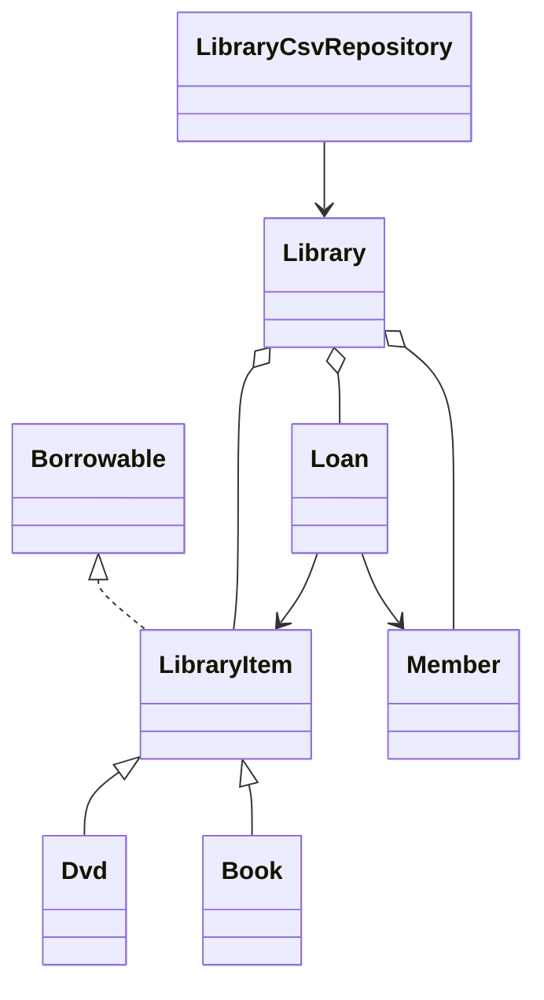

# Lab 11 Report

The project demonstrates Singleton configuration, Factory notifications, Strategy discounts, and Observer grade alerts. The library uses an abstract `LibraryItem`, `Book` and `Dvd` subclasses, the `Borrowable` interface, checked domain exceptions, map-backed lookup, stream search/overdue reports, and CSV persistence.

Compile with `javac *.java`; run `java Lab11Test`, `java Lab11Runner`, or `java LibraryConsole`.
